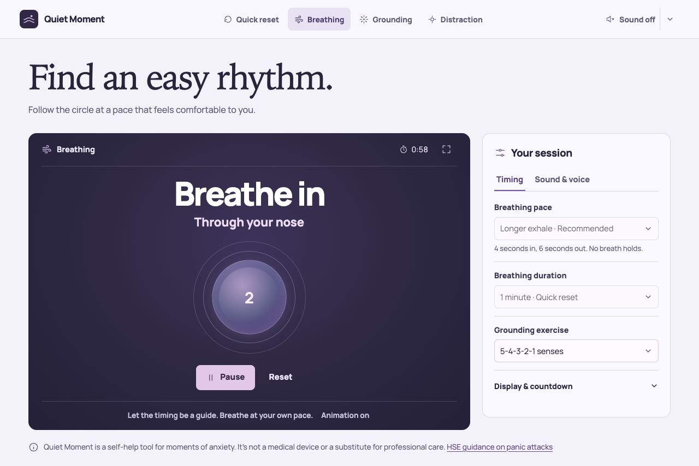
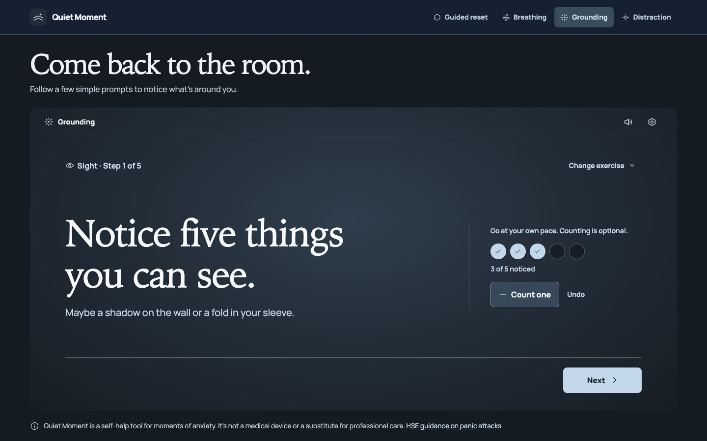
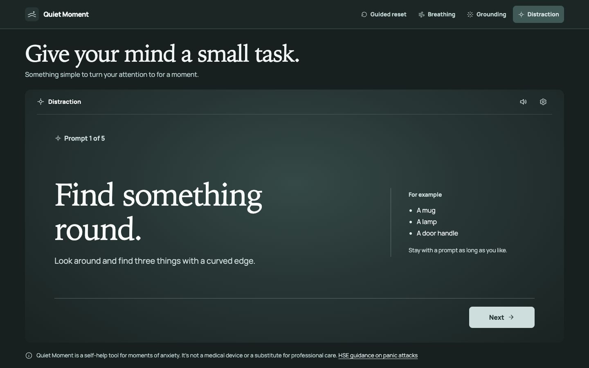

# Quiet Moment

Guided breathing, sensory grounding, and simple distractions for anxious moments. Start by tapping the circle, or choose an exercise from the top of the page.

Try it out on https://quiet-moment-lovat.vercel.app/

> [!IMPORTANT]
> **For general self-help only.** Quiet Moment offers guided exercises. Its scope excludes medical diagnosis, treatment, and medical-device functions. For medical advice or care, speak with a qualified healthcare professional.
>
> **If you need emergency help in Ireland, call 112 or 999.** If you’re elsewhere, call your local emergency number. [HSE guidance on urgent mental health help](https://www2.hse.ie/mental-health/services-support/get-urgent-help/)

## Find professional support

- **Talk to a GP or find counselling.** The HSE explains how to access counselling and psychotherapy, including free and low-cost options. [HSE guide to getting talk therapy](https://www2.hse.ie/mental-health/services-support/talk-therapy/get/)
- **Find mental health services in Ireland.** The HSE’s Your Mental Health information line can explain what services are available and how to access them. [Your Mental Health information line](https://www2.hse.ie/mental-health/services-support/your-mental-health-information-line/)
- **Read about panic attacks and when to seek care.** [HSE guidance on panic attacks](https://www2.hse.ie/mental-health/issues/how-to-deal-with-panic-attacks/)

## Start a quick reset

1. Choose **Quick reset** and tap **Start** in the centre of the circle. With the default settings, there’s a short preparation countdown followed by about a minute of guided breathing.
2. Follow the **In**, **Out**, and **Hold** cues in the circle at a pace that feels comfortable. Tap the circle or **Pause** to take a break. Tap again to resume, or choose **Reset** to go back to the start.
3. When breathing ends, the app opens a grounding exercise. You can also choose **Grounding** in the player header during the session.


## Choose an exercise

### Breathing

Choose **Breathing** for a session on its own. The cue shows when to breathe in through your nose and out through your mouth. The centre grows and shrinks with the breath. The outer ring fills clockwise once per cycle, with a notch at each cue change. Open the settings gear in the page header and choose a pace under **Timing** to see its inhale, exhale, and hold times, or set your own. Set either custom hold to zero to skip it.



### Grounding

Work through the senses one at a time. Tap a number to record how many things you’ve noticed. Tapping **3**, for example, marks the first three and shows **3 / 5 noticed**. Choose **Next prompt** when you’re ready or **Skip prompt** to move on earlier.



### Distraction

Try a small task, such as finding round objects nearby. Each prompt includes examples, and **Another prompt** lets you move on at your own pace.



## Use Quiet Moment on a phone

The page adapts to the screen width automatically. On a phone, the exercise fills a single column. The gear opens **Settings** from the page header.


## Set up your session

- **Sound.** Tap the sound icon in the header to play or mute background audio. Open **Sound & voice** in Settings to choose rain, slow tide, or **Breathing lo-fi**. Breathing lo-fi follows your rhythm and pauses and resumes with the countdown.
- **Spoken cues.** Open **Sound & voice** in Settings to enable spoken instructions in supported browsers.
- **Animation and countdowns.** Open **Timing** to change the preparation countdown. **Display** has the countdown and animation controls. The circle still shows the breath cue if you hide the numbers. Animation is on by default. Choose **Follow system setting** or **Keep circle still** to change it.

## Open it locally or offline

If you have a copy of `Quiet-Moment.html`, open it in your browser. It includes the exercises and audio and can run offline. Your session preferences are stored in your browser.

If you have the source code, use Node 24 and pnpm 12.16.1 from the project folder.

```sh
pnpm install --frozen-lockfile
pnpm run dev
```

Open [localhost:5173](http://localhost:5173/). To make your own offline copy, run `pnpm run build:offline` and open `dist/Quiet-Moment.html`.

### For contributors

Quiet Moment uses Vue 3, TypeScript, Vite, and Tailwind CSS. Run `pnpm run check` for linting, formatting, type checks, tests, and a production build. The [contributor guide](AGENTS.md) maps the code and documents the behavior that tests and changes should preserve.

## Appearance

Open **Settings → Display → Appearance** to choose System, Light, or Dark. System follows your device. Your choice is remembered in the browser.
