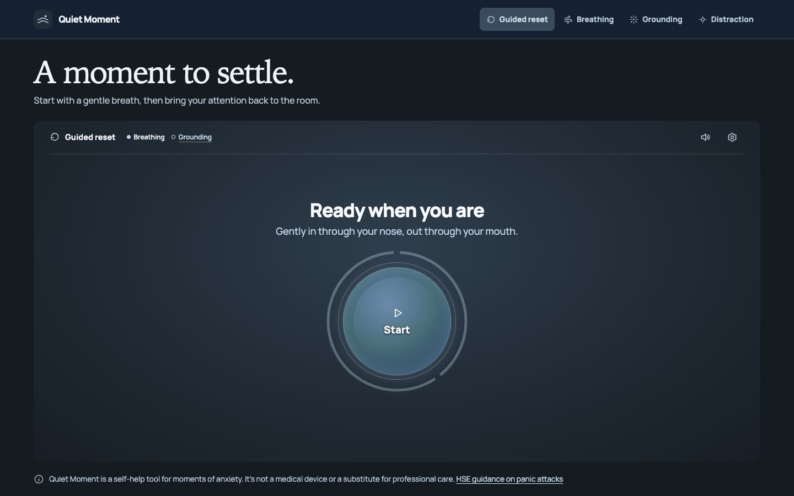
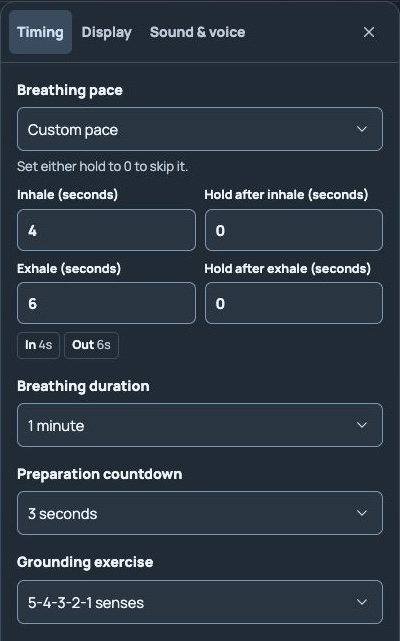
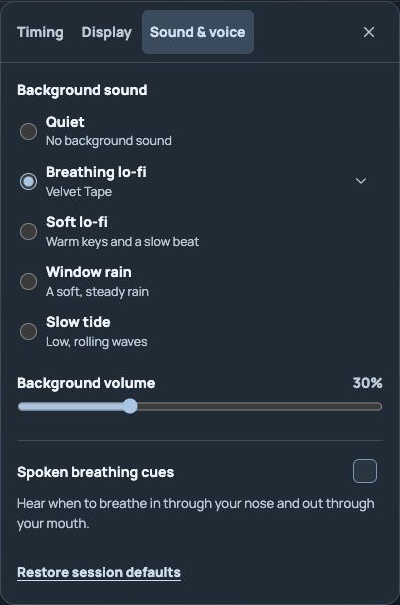
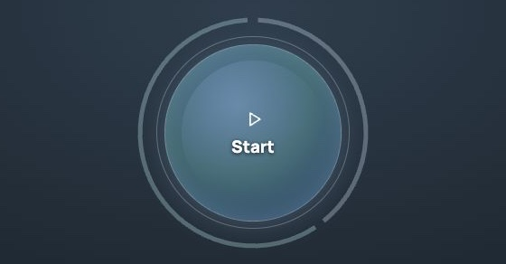
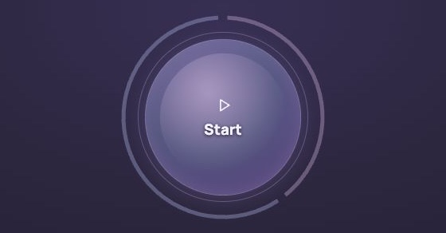
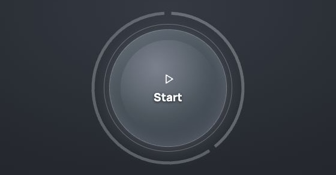
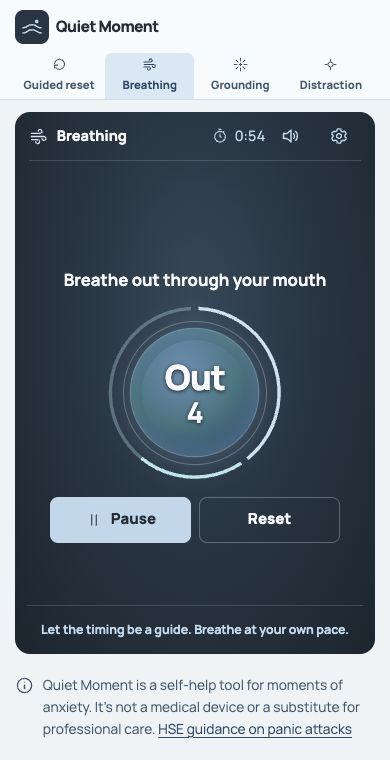

# Quiet Moment

Quiet Moment offers guided breathing, sensory grounding, and simple distractions for anxious moments.

[Open Quiet Moment](https://quiet-moment-lovat.vercel.app/)

> [!IMPORTANT]
> **For general self-help only.** Quiet Moment offers guided exercises. Its scope excludes medical diagnosis, treatment, and medical-device functions. For medical advice or care, speak with a qualified healthcare professional.
>
> **If you need emergency help in Ireland, call 112 or 999.** If you’re elsewhere, call your local emergency number. [HSE guidance on urgent mental health help](https://www2.hse.ie/mental-health/services-support/get-urgent-help/)

## Start a guided reset

1. Choose **Guided reset** and tap **Start** in the centre of the circle. The default session starts with a short countdown and about a minute of guided breathing.
2. Follow the cues in the circle. Tap the circle or **Pause** to take a break. Choose **Resume** to continue or **Reset** to go back to the start.
3. Grounding opens automatically when breathing ends. Choose **Grounding** in the player header to move on sooner.



## Choose an exercise

Use the top navigation to open an exercise directly.

| Breathing                                                                                        | Grounding                                                                                           | Distraction                                                                                  |
| ------------------------------------------------------------------------------------------------ | --------------------------------------------------------------------------------------------------- | -------------------------------------------------------------------------------------------- |
|             |               |  |
| Follow the circle as it expands and contracts. The ring shows your progress through each breath. | Use one sense at a time. **Change exercise** offers 5-4-3-2-1, Quick 3-2-1, and Orient to the room. | Try a small task, such as finding round objects nearby. Each prompt includes examples.       |

In Grounding, **Count one** and **Undo** help you keep track. Counting is optional. Choose **Next** at your own pace or use **Back** to return to your previous count. The final button is **Finish** in Grounding and **Start over** in Distraction.

## Customise your session

Open the gear in the top-right corner of the player. Quiet Moment saves your choices in your browser.

- **Timing.** Pick a breathing pace or set your own inhale, exhale, and hold times. Set a hold to zero to skip it. You can also change the session length, preparation countdown, and grounding exercise.
- **Sound & voice.** Choose **Quiet**, **Soft lo-fi**, **Window rain**, **Slow tide**, or **Breathing lo-fi**. Use the chevron beside **Breathing lo-fi** to switch from the default **Velvet Tape** to **Warm Keys** or **Afterglow**. All three follow your breathing pace. Adjust background volume or enable spoken cues in supported browsers.
- **Display.** Show or hide countdowns. Under **Breathing animation**, choose **Always animate**, **Follow system setting**, or **Keep circle still**. Appearance and colour theme are in the same tab.

| Timing                                                                                                                                 | Sound & voice                                                                                             |
| -------------------------------------------------------------------------------------------------------------------------------------- | --------------------------------------------------------------------------------------------------------- |
|  |  |

### Colour themes

Open **Settings → Display → Color theme** to change the palette. **Appearance** lets you choose **Light**, **Dark**, or **System** to follow your device. The walkthrough uses Ocean blue.

|                           Ocean blue                            |                            Purple                            |                           Slate                            |
| :-------------------------------------------------------------: | :----------------------------------------------------------: | :--------------------------------------------------------: |
|  |  |  |

## Use Quiet Moment on a phone

The same exercises and settings are available in a single-column layout.



## Find professional support

- **Talk to a GP or find counselling.** The HSE explains how to access counselling and psychotherapy, including free and low-cost options. [HSE guide to getting talk therapy](https://www2.hse.ie/mental-health/services-support/talk-therapy/get/)
- **Find mental health services in Ireland.** The HSE’s Your Mental Health information line can explain what services are available and how to access them. [Your Mental Health information line](https://www2.hse.ie/mental-health/services-support/your-mental-health-information-line/)
- **Read about panic attacks and when to seek care.** [HSE guidance on panic attacks](https://www2.hse.ie/mental-health/issues/how-to-deal-with-panic-attacks/)

## Open it locally or offline

If you have a copy of `Quiet-Moment.html`, open it in your browser. It includes the exercises and audio and can run offline. Your session preferences are stored in your browser.

If you have the source code, use Node 24 and pnpm 12.16.1 from the project folder.

```sh
pnpm install --frozen-lockfile
pnpm run dev
```

Open [localhost:5173](http://localhost:5173/). To make your own offline copy, run `pnpm run build:offline` and open `dist/Quiet-Moment.html`.

### For contributors

Quiet Moment uses Vue 3, TypeScript, Vite, and Tailwind CSS. Run `pnpm run check` for linting, formatting, type checks, tests, and a production build. The [contributor guide](AGENTS.md) maps the code and documents the behavior that tests and changes should preserve.
